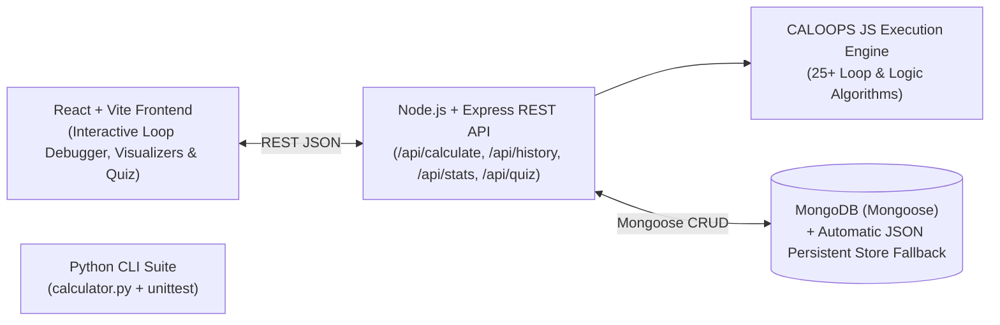

# CALOOPS v2.0 — Full-Stack MERN + Python Logic & Loops Scientific Calculator

🌐 **Live 24/7 Public HTTPS App URL**: [https://nikhil2006-stack.github.io/caloops/](https://nikhil2006-stack.github.io/caloops/)

A complete **MERN Stack (MongoDB, Express.js, React, Node.js)** web application and **Python CLI suite** designed to help you master programming logic, boolean algebra, bitwise tricks, and every major loop paradigm (`for`, `while`, 2D/3D nested loops, Shunting-Yard RPN stack loops, numerical calculus loops, and convergence loops) with **real-time step-by-step execution tracing** and **Login / Mobile OTP Verification**.

---

## Architecture Overview



### 1. Frontend (`frontend/` — React 18 + Vite)
- **9 Interactive Domain Tabs**:
  1. **Expression & RPN**: Dijkstra's Shunting-Yard Infix-to-Postfix stack loop evaluator with keypad and `ans`/`pi`/`e` variables.
  2. **Loop Arithmetic**: Multiplication via repeated addition (`for`), Division (`Q, R`) via repeated subtraction (`while`), Exponentiation (`for`), and AP/GP progressions.
  3. **Primes & Number Theory**: Early-exit $\sqrt{n}$ prime checker, Sieve of Eratosthenes, trial-division Prime Factorization, Perfect/Abundant/Deficient/Harshad classifier, Euclidean GCD/LCM, and Digit Extraction (`% 10`, `// 10`).
  4. **Combinatorics & Pascal**: $n!$, Fibonacci tuple-swap loop, $nCr$ & $nPr$, and interactive 2D Pascal's Triangle Pyramid visualizer.
  5. **Logic, Bitwise & Bases**: 7-Gate Boolean Truth Table (`AND`, `OR`, `XOR`, `NAND`, `NOR`, `XNOR`, `IMPLIES`), Bitwise calculator, Brian Kernighan `n &= (n - 1)` 1-bit popcount, and Horner Base `2..36` converter.
  6. **Calculus & Convergence**: Collatz $3n+1$ hailstone loop, Newton-Raphson $\sqrt{x}$, Maclaurin/Taylor Series ($\sin x, \cos x, e^x$), and Trapezoidal Definite Integration.
  7. **Matrix 3D Loops**: 2D Matrix Addition, **3D Triple-Nested Loop (`i, j, k`) Matrix Multiplication**, Transpose, and Cofactor Determinant.
  8. **Sorting, Search & Stats**: Bubble Sort & Insertion Sort pass visualizer, Binary Search (`while low <= high`), and Two-Pass Descriptive Statistics.
  9. **Mastery Quiz & DB Leaderboard**: 5-question interactive quiz with explanations and persistent database leaderboard.
- **Step-by-Step Loop Trace Debugger**: Step backward/forward (`◀ Prev`, `Next ▶`), animate iterations (`▶ Animate Loop`), or inspect all iterations with time-complexity badges.

### 2. Backend (`backend/` — Node.js + Express.js)
- `POST /api/calculate` — Executes any of the 25+ loop/logic algorithms, records execution time in ms, and saves the trace to the database.
- `GET /api/history` — Lists saved calculations with category and favorite filters.
- `PATCH /api/history/:id/favorite` — Stars/unstars a calculation in the database.
- `DELETE /api/history/:id` & `DELETE /api/history` — Deletes single or all history records.
- `GET /api/stats` — Aggregates total calculations, total loop steps traced, category breakdown, and active database status.
- `GET /api/quiz` & `POST /api/quiz/submit` — Serves quiz questions, grades submissions, and updates the leaderboard.

### 3. Database (`backend/models/` & `backend/config/db.js` — MongoDB + Hybrid Store)
- Uses **Mongoose** schemas ([Calculation.js](file:///c:/Users/HP/Desktop/caloops/backend/models/Calculation.js) and [QuizScore.js](file:///c:/Users/HP/Desktop/caloops/backend/models/QuizScore.js)) to connect to `MONGODB_URI` (defaults to `mongodb://127.0.0.1:27017/caloops`).
- Automatically falls back to a persistent local JSON database (`backend/data/caloops_db.json`) if a local `mongod` service is not running, so the full stack works out of the box with zero configuration.

---

## Getting Started

### Run the Full-Stack MERN Application
```bash
# 1. Install backend and frontend dependencies
npm.cmd --prefix backend install
npm.cmd --prefix frontend install

# 2. Build the React production bundle (served automatically by Express on port 5000)
npm.cmd --prefix frontend run build

# 3. Start the MERN server (http://localhost:5000)
node backend/server.js
```

Or run Frontend Vite Dev Server (`http://localhost:5173`) + Backend API (`http://localhost:5000`) separately:
```bash
# Terminal 1: Backend API
npm.cmd --prefix backend run dev

# Terminal 2: React Vite Dev Server
npm.cmd --prefix frontend run dev
```

### Run Automated Tests (Backend Node + Python CLI)
```bash
# Node.js Backend Engine Tests
node --test backend/test/engine.test.js

# Python CLI Unit Tests
python -m unittest discover -v
```
